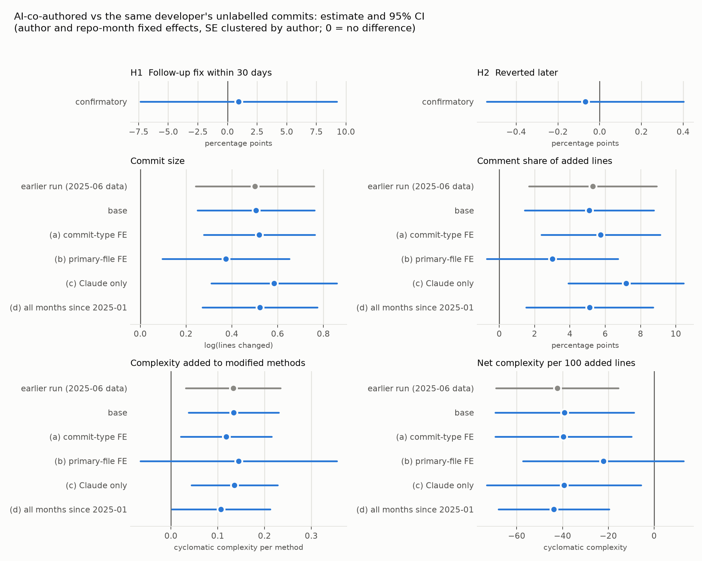

# Design 3: within-developer comparison of AI-co-authored and unlabelled commits

Overnight run of 2026-11-02. The analysis plan (`ANALYSIS_PLAN.md`) was fixed
and hashed before H1-H3 were run; it is not a formal pre-registration. Only
the four tests in the confirmatory table are hypotheses from that plan;
everything below the "Exploratory" heading is exploratory.

## Summary

- **No evidence that AI-co-authored commits need more follow-up fixes or get
  reverted more often** than the same developer's unlabelled commits in the
  same months (H1 +0.9 pp, 95% CI -7.4 to 9.2; H2 -0.07 pp, -0.54 to 0.40;
  both BH-adjusted p = 0.82). This is absence of evidence, not evidence of
  equality: the H1 interval spans about 17 points on a base rate of 21%, and
  reverts are so rare (14 in 4,646 commits) that H2 has little power.
- **No comment-share spillover** to developers' unlabelled work after they
  start labelling AI commits (H3a -0.9 pp, -2.7 to 0.9; p_BH = 0.64).
- **H3b is significant, but in the direction opposite to spillover**: after
  adoption, a developer's unlabelled commits are about 16% *smaller* than the
  common trend among non-adopters predicts (log size -0.175, -0.300 to
  -0.050; p_BH = 0.025); in raw terms they stay about the same size, while
  their labelled commits are larger. One reading, formed after the fact (the
  test was designed for spillover), is that developers hand the larger tasks
  to the assistant.
- **Of the four earlier findings, only commit size is robust** by the plan's
  rule: AI-co-authored commits are about 1.66x larger in the base model (log
  +0.51, 0.25 to 0.76) and 1.45x to 1.79x across the variants, with every CI
  excluding zero. The variant (b) cell is the fragile one: across tie-breaking
  rules for the primary file and the fixed-code sensitivity run, the (b)
  estimate ranges from 0.32 to 0.39 and its reghdfe-style p from 0.015 to
  0.045 (see H4 and "Sensitivity"). Comment share (+5.1 pp), complexity added to modified methods
  (+0.13) and net complexity per 100 added lines (-39) keep their sign in
  every variant but their CI includes zero when the comparison is restricted
  to commits whose main file is the same (variant b). "Robust" means robust
  to specification on the same labelled commits as the earlier run, not a
  replication on new data.
- Exploratory: the comment-share difference is driven by Claude-labelled
  commits (+6.9 pp; Junie +1.9 pp, n.s.), with a larger point estimate for
  Claude 5.x (+12.6 pp) than 4.x (+5.3 pp). Adding intellij-community
  (4 more developers) weakens it to +3.8 pp (-0.1 to 7.7), while size and
  complexity hold in the pooled estimate (in intellij-community alone the
  size difference is about zero).

## Data and window

| | ideavim | intellij-scala | kotlin |
|---|---|---|---|
| Non-merge commits since 2025-01-01 (bots other than AI agents removed) | 2,288 | 4,388 | 25,063 |
| of which AI-co-authored (`pair`) | 326 | 361 | 1,216 |
| AI-agent commits (`agent`, not analysed) | 183 | 0 | 14 |
| Last commit in data | 2026-10-30 | 2026-10-31 | 2026-10-31 |
| AI-active months (months with a `pair` production commit) | 2025-12 to 2026-10 (10) | 2026-03 to 2026-10 (8) | 2026-01 to 2026-10 (10) |

- Clones of the default branches taken 2026-11-02 with history from
  2024-12-01 (`run_mining.sh`); metrics from `mine_commits.py` (pydriller
  2.12, lizard 1.24.3), file-level history from `file_history.py`.
- Groups: `pair` = human author with an AI co-author / "Generated with" /
  "Assisted-by" trailer; `human` = unlabelled human commit; `agent` = commit
  authored by an AI bot account. Production code = `.kt/.kts/.java/.scala`
  outside test paths.
- 23,227 production-code commits since 2025-01; 11,699 in AI-active months.
- **Eligible developers** (>= 8 `pair` and >= 8 `human` production commits in
  AI-active months): **19** (2 ideavim, 3 intellij-scala, 14 kotlin) with
  **4,646 commits, 1,204 of them AI-co-authored** (Claude 958, Junie 150,
  Codex 95, Cursor 1). The earlier run had 20; Anton Bannykh no longer
  qualifies because agent-bot commits no longer define AI-active months
  (deviation 5 below).
- The labelled production commits start in December 2025 (ideavim), January
  2026 (kotlin) and March 2026 (intellij-scala). In kotlin, the only
  AI-labelled production commits in July-October 2025 are 8 agent-bot commits.

## Analysis plan

`ANALYSIS_PLAN.md` was fixed and hashed before H1-H3 were run, and was not
modified. `shasum -a 256 -c ANALYSIS_PLAN.sha256` returns
`ANALYSIS_PLAN.md: OK` for SHA-256
`420dd1d1a9b7267c56dae38e9b9b635fa3d842f391342fde64c29630d5fcd91e`, hashed at
2026-11-02T03:45:29Z (04:45 CET).

Note: the 04:50 CET in the plan's header was an estimate; the hash time
(04:45 CET) is the correct one.

Before the analysis was run, `analyze_overnight.py` was read against the plan
and six differences were recorded in `PROGRESS.md` and committed
(commit 62864e9, 05:01 CET), together with `plan_conformance.py`, which
re-estimates the two that could change a conclusion. See "Deviations".

## Confirmatory results

Model for each test: linear probability / OLS with author and repository-month
fixed effects (absorbed by alternating demeaning), standard errors clustered
by author, two-sided, Benjamini-Hochberg across the four tests.

| Test | Outcome and term | Estimate | 95% CI | p | p (BH) | n | Clusters |
|---|---|---|---|---|---|---|---|
| H1 | Follow-up fix within 30 days, `pair` | +0.0094 | -0.0736 to 0.0924 | 0.825 | 0.825 | 4,188 | 19 |
| H2 | Reverted later, `pair` | -0.0007 | -0.0054 to 0.0040 | 0.774 | 0.825 | 4,646 | 19 |
| H3a | Comment share of added lines, `post_unlabelled` | -0.0090 | -0.0267 to 0.0087 | 0.320 | 0.640 | 21,475 | 114 |
| H3b | log(lines changed), `post_unlabelled` | **-0.1752** | **-0.3004 to -0.0499** | 0.006 | **0.025** | 22,438 | 114 |

- **H1.** Raw follow-up-fix rates are 21.4% for unlabelled and 27.6% for
  AI-co-authored commits (3,247 and 941 eligible commits). Most of this gap
  comes from which developers and repositories contribute AI-co-authored
  commits (the rate is 0.42 in intellij-scala and 0.19 in kotlin): within
  developer, the gap weighted by AI-co-authored commits is +2.0 pp, and 12 of
  19 developers have a higher rate on their AI-co-authored commits. With the
  controls and month effects the estimate is +0.9 pp; its interval (-7.4 to
  9.2) is compatible with no difference and with moderate differences either
  way. The 30-day cut-off removes 22% of AI-co-authored but only 6% of
  unlabelled commits, because labelled commits cluster in the last months
  (`results_overnight/inference_checks.txt`).
- **H2.** 12 of 3,442 unlabelled and 2 of 1,204 AI-co-authored commits were
  reverted. Fisher's exact test on the pooled table: odds ratio 0.48,
  p = 0.54. With 14 reverts the test can only rule out large differences.
- **H3.** 20 adopters (>= 8 labelled commits and >= 20 production commits
  before the first one) and 94 non-adopters with >= 20 production commits.
  Raw means for adopters: before adoption log size 3.33 and comment share
  10.9%; their unlabelled commits after adoption 3.36 and 13.8%; their
  labelled commits 3.68 and 20.3%. Relative to the common trend, the
  labelled commits are larger (+0.295, 0.098 to 0.492) and more commented
  (+4.6 pp, 0.9 to 8.3), whereas the unlabelled commits after adoption are
  smaller (H3b) and no more commented (H3a). The script's sensitivity check
  that keeps only never-labelled developers as controls gives the same H3a
  answer (-0.75 pp, -2.8 to 1.3, p = 0.47).

With the plan's exact controls for H2 (adding log(production files)) the
estimate is unchanged (-0.0007, p = 0.782) and the BH-adjusted p-values of all
four tests are identical (`results_overnight/plan_conformance_output.txt`).

## H4: robustness of the earlier findings

Estimate of `pair` (AI-co-authored vs own unlabelled commits), 95% CI in
brackets. Non-size outcomes control for log(lines changed). The plan calls a
finding robust if its sign is unchanged and its CI excludes zero in each of
(a)-(d).

| Outcome | Earlier run | Base | (a) commit-type FE | (b) primary-file FE | (c) Claude only | (d) all months since 2025-01 | Verdict |
|---|---|---|---|---|---|---|---|
| log(lines changed) | +0.50 [0.24, 0.76] | +0.51 [0.25, 0.76] | +0.52 [0.28, 0.76] | +0.37 [0.10, 0.65] | +0.58 [0.31, 0.86] | +0.52 [0.27, 0.77] | **robust** |
| Comment share of added lines (pp) | +5.3 [1.7, 8.9] | +5.1 [1.5, 8.8] | +5.7 [2.4, 9.1] | +3.0 [-0.7, 6.7] | +7.2 [3.9, 10.4] | +5.1 [1.5, 8.7] | not robust (b) |
| Complexity added to modified methods | +0.13 [0.03, 0.23] | +0.13 [0.04, 0.23] | +0.12 [0.02, 0.22] | +0.14 [-0.07, 0.35] | +0.14 [0.04, 0.23] | +0.11 [0.00, 0.21] | not robust (b) |
| Net complexity per 100 added lines | -42 [-69, -16] | -39 [-69, -9] | -40 [-69, -10] | -22 [-57, 13] | -39 [-73, -6] | -44 [-68, -20] | not robust (b) |

n (base) = 4,646 / 4,416 / 3,179 / 3,451 commits; 19 clusters in every cell.
The plan-worded verdict and the script's verdict agree.

Variant (b) adds the primary production file (most added lines) as a fixed
effect. 1,530 of the 2,311 primary files have a single commit, and only 1,566
commits (576 AI-co-authored) have a primary file that both groups touched, so
the variant compares like with like but on about a third of the data. The
point estimates for comment share and net complexity shrink by about 40% in
(b); complexity added to modified methods does not shrink, its interval only
widens.

**Variant (b) and the small-sample correction.** `analyze_overnight.py` does
not count absorbed fixed effects in the clustered small-sample correction.
That is standard for author effects, which are nested in the author clusters,
and negligible for the ~28 repository-month effects, but the 2,311
primary-file effects are not nested in authors. Counting them
(`inference_checks.py`, added after the results): with singleton files
dropped first, as reghdfe does, the size SE grows by a factor of 1.16 and
commit size in (b) still excludes zero (p = 0.023; 0.036 with t(18)); counting
every singleton file as well grows it by 1.42 and gives p = 0.063. The robust
verdict for commit size therefore holds under the usual convention but not
under the most conservative count. The other three outcomes fail (b) either
way.



*Estimates of `pair` with 95% CIs. Grey: the earlier run on 2025-06 to 2026-11
data. H1 and H2 are the confirmatory models; the other four panels show the
base model and the H4 variants.*

## Verification with fresh code

Written by a separate agent that worked only from the plan's definitions, the
CSV data and `git` on the clones, without opening any of the analysis
scripts. Details, scripts and commit-level files are in `verification/`
(`VERIFICATION.md`).

| Check | Fresh code | Analysis | Verdict |
|---|---|---|---|
| (a) AI-co-authored commits, plain `git log --grep -i -E`, since 2025-01 (non-bot authors) | ideavim 326, intellij-scala 358, kotlin 1,216 | 326, 361, 1,216 | agree: identical SHA sets in ideavim and kotlin. The 3 extra intellij-scala commits touch no production code: two have a literal `\n` typed before `Co-authored-by: Codex`, and one says "generated with Claude Agent" in prose |
| (a) ... touching production code | 151, 239, 864 | 152, 239, 864 | agree up to one ideavim commit, explained by bug 1 below |
| (b) 30-day follow-up-fix rate, intellij-scala, eligible core commits | unlabelled 0.4316 (285), AI 0.4010 (192) | 0.4281, 0.4010 | agree: eligibility identical for all 548 rows, outcome identical for 476 of 477; the one difference is bug 2 below |
| (c) H4 comment share, base, explicit author and repo-month dummies | 0.051006, SE 0.0187 | 0.051006, SE 0.0186 | agree: identical coefficient; the SE differs by 0.5% because the analysis does not count absorbed fixed effects in the small-sample correction (where this matters more, in variant (b), see H4) |
| (c) H4 log(lines changed), base, explicit dummies | 0.505621 | 0.505621 | agree |

Scope: the verification re-implemented the AI labels, the follow-up-fix
outcome and one regression. It took the core sample (19 developers, 4,646
commits) and the AI-active months from the analysis' own
`overnight_core_commits.csv` and did not re-estimate the H1-H3 models.

The verification found three small defects in the mining code. They were
fixed after the main run and their effect is measured in "Sensitivity: fixed
mining code" below; `results_overnight/` is unchanged:

1. `*Test.kts` files count as production code (the test-name rule covers
   `.kt/.java/.scala` only). One path in the three repositories is affected
   (`.teamcity/patches/buildTypes/SlackNotificationTest.kts` in ideavim), which
   puts one AI-co-authored ideavim commit into the core sample.
2. `file_history.py` keeps only the new path of a renamed file. A fix commit
   that renames and edits a file is therefore not linked to earlier commits on
   the old path; in intellij-scala this loses 1 of about 200 follow-ups.
   Only 2, 14 and 16 fix-subject commits since 2025 rename a production file
   in ideavim, intellij-scala and kotlin (`inference_checks.py`), which bounds
   how many follow-up links can be missing; kotlin's effect was not measured
   commit by commit.
3. `jetbrains-junie[bot]` commits (2 in ideavim, 2 in intellij-scala) are
   dropped as "other bots" instead of being labelled `agent`. Only agent
   counts are affected, and agents are not analysed.

The tool labels have three slips that do not change who is in which group but
do touch E1: three kotlin commits with ChatGPT trailers are labelled Codex (an
`openai` address is checked before `chatgpt`), one commit is labelled Claude
because its subject mentions Claude, and one intellij-scala core commit with
both a Codex and a Claude trailer counts as Claude only.

**Inference with t(18) instead of the normal approximation.** With 19
clusters a t reference is the more cautious choice. Recomputing every
19-cluster interval with t(18) changes one H4 cell: complexity added to
modified methods in variant (d) goes from p = 0.046 to p = 0.061. That outcome
already fails robustness in variant (b), so no verdict changes, and the four
confirmatory p-values move only in the third decimal (H1 0.825 -> 0.827,
H2 0.774 -> 0.777, H3a 0.320 -> 0.322, H3b 0.0061 -> 0.0071 with 114
clusters). Computed in `results_overnight/inference_checks.txt`; the
verification's `c_dummy_regression_output.txt` gives the same H4 result.

## Sensitivity: fixed mining code

A separately labelled rerun, `results_sensitivity/`, made after the main
results were known. It uses the same clones and the same analysis script; only
the mining code differs. Compared with the code that produced
`results_overnight/` (the mining scripts as of commit 24d7497), it has four
fixes:

1. `*Test.kts` and `*Spec.kts` files are test code.
2. A rename also records the old path (as a zero-line row), so a fix commit
   that renames a file is linked to earlier commits on the old path.
3. `jetbrains-junie[bot]` is classified as an agent instead of being dropped.
4. `file_history.py` pins rename detection
   (`git -c diff.renames=true -c diff.renameLimit=1000 log -M`) and its start
   time (`--since=2025-01-01 00:00:00`). Without a time, git uses the current
   time of day, so the commit list depended on when the script ran. Run at
   21:26 it dropped two ideavim dependabot commits from the afternoon of
   2025-01-01 that the 04:58 run kept. With the pinned time the commit sets
   equal the main run's.

Commands: `./run_sensitivity.sh`, then `python3 sensitivity_compare.py`,
`python3 plan_conformance.py results_sensitivity` and
`python3 inference_checks.py results_sensitivity`.

What changes in the data:
- The core sample loses one commit (the ideavim `Test.kts` commit), leaving
  19 developers and 4,645 commits (1,203 AI-co-authored). The four junie-bot
  commits enter as agents and are not in the core sample.
- Among common core commits, the follow-up-fix outcome changes for one
  (intellij-scala, unlabelled, 0 -> 1: the rename case the verification
  found) and the prior-fix control for 11.
- One ideavim commit's log size changes, because it also touched the `.kts`
  test file. 8 ideavim values of net complexity per 100 added lines move
  slightly (454.1 -> 454.7 and -36.5 -> -36.6), because the winsorizing
  percentiles are computed over all mined commits of a repository, and in
  ideavim those now differ.
- 251 commits get a different primary file. 244 of them are commits whose
  top production files tie on added lines. `analyze_overnight.py` breaks such
  ties with an unstable sort, so adding rows reshuffles them. In 8 commits the
  new primary file is a pre-rename path, which happens when no file in the
  commit adds lines.

| Test | Main | Sensitivity |
|---|---|---|
| H1 follow-up fix | +0.0094 [-0.0736, 0.0924], p_BH 0.825 | +0.0100 [-0.0734, 0.0935], p_BH 0.814 |
| H2 reverted | -0.0007 [-0.0054, 0.0040], p_BH 0.825 | -0.0007 [-0.0054, 0.0040], p_BH 0.814 |
| H3a comment-share spillover | -0.0090 [-0.0267, 0.0087], p_BH 0.640 | identical |
| H3b size spillover | -0.1752 [-0.3004, -0.0499], p_BH 0.0245 | -0.1751 [-0.3004, -0.0498], p_BH 0.0246 |

The plan-exact H2 (p = 0.782) and the BH-adjusted values agree as before. All
H4 cells are identical to three decimals except variant (b): commit size
+0.317 [0.050, 0.583] (main +0.373), comment share +3.1 pp [-0.8, 6.9],
complexity added +0.15 [-0.04, 0.34], net complexity -22 [-54, 10]. **Every
H4 verdict is unchanged**: commit size is robust and the other three fail in
(b).

**Variant (b) for commit size is sensitive to arbitrary choices.** 424 core
commits (9%) tie for the primary file. Re-estimating size in (b) with two
deterministic tie-breaks (`sensitivity_compare.py`), and using the reghdfe
convention (singleton files dropped, file effects counted):

| File history | Tie-break | log size in (b) | p, reghdfe-style SE | p, same with t(18) |
|---|---|---|---|---|
| main | analysis (unstable sort) | +0.373 | 0.023 | 0.036 |
| main | alphabetically first path | +0.381 | 0.015 | 0.025 |
| main | alphabetically last path | +0.391 | 0.015 | 0.026 |
| sensitivity | analysis (unstable sort) | +0.317 | 0.045 | 0.060 |
| sensitivity | alphabetically first path | +0.316 | 0.021 | 0.033 |
| sensitivity | alphabetically last path | +0.392 | 0.015 | 0.025 |

With the normal reference that the analysis uses throughout, size in (b)
excludes zero in all six versions. With t(18) it excludes zero in five of the
six. The commit-size verdict therefore stands, but its (b) cell rests on a
primary-file definition that the plan does not pin down for ties.

## Exploratory (not in the analysis plan's hypotheses)

Each row compares the named subset of AI-co-authored commits with the same
developers' unlabelled commits (author and repository-month fixed effects,
SE clustered by author, 19 clusters, no multiple-testing correction).

| Group | Commits (developers) | Comment share (pp) | log(lines changed) | Complexity added to modified methods |
|---|---|---|---|---|
| E1 Claude | 958 (17) | +6.9 [3.7, 10.2] | +0.59 [0.32, 0.85] | +0.12 [0.03, 0.21] |
| E1 Junie | 150 (7) | +1.9 [-1.9, 5.6] | +0.19 [-0.31, 0.68] | +0.10 [-0.34, 0.54] |
| E1 Codex | 95 (3; 93 from one developer) | -9.7 [-12.2, -7.3] | +0.17 [-0.03, 0.37] | +0.34 [0.25, 0.43] |
| E2 Claude Opus | 715 (17) | +9.1 [4.7, 13.6] | +0.67 [0.50, 0.84] | +0.18 [0.05, 0.31] |
| E2 Claude Fable | 97 (7) | +7.8 [1.2, 14.5] | +0.69 [0.20, 1.18] | +0.21 [-0.01, 0.44] |
| E2 Claude Sonnet | 71 (6) | +7.4 [-7.0, 21.8] | +0.72 [0.35, 1.10] | +0.20 [0.04, 0.36] |
| E3 Claude 4.x | 429 (17) | +5.3 [2.8, 7.8] | +0.65 [0.45, 0.85] | +0.11 [-0.01, 0.23] |
| E3 Claude 5.x | 454 (15) | +12.6 [7.4, 17.8] | +0.71 [0.49, 0.93] | +0.26 [0.02, 0.51] |

- The Codex row is in effect one intellij-scala developer's contrast; its
  narrow interval reflects that, not precision about Codex.
- 75 Claude-labelled commits name no model and are left out of E2 and E3.
  The 5.x models appear later in time than the 4.x models; repository-month
  fixed effects absorb the common trend, but not a developer's own learning.
- The plan also lists "agent-bot commits vs human commits" as exploratory.
  It was skipped by decision: agent commits have no human author, so they
  cannot enter the within-developer model (ideavim has 183, kotlin 14).

**Other sampled repositories.** In the refreshed `llm_signals_summary.csv`
three other sampled repositories have >= 20 AI-authored commits:
intellij-community (95), sbt-ide-settings (25) and kotlin-web-site (24).
Only intellij-community has eligible developers (4; sbt-ide-settings has one
production commit since 2025, kotlin-web-site one AI-co-authored production
commit). Mining all of intellij-community's ~60,000 production commits since
2025 was not feasible overnight, so `mine_selected.py` mined the commits the
within-developer model needs from it (the 4 developers' commits and every
AI-labelled commit since 2025-09-01, 4,173 commits) with `mine_commits.py`'s
metric code unchanged. In X2, two AI-labelled intellij-community commits by
developers who are eligible in another repository enter the core sample
without their unlabelled intellij-community commits, because developers are
matched by name across repositories; the effect is negligible.

Caveat on the screen: the candidate list comes from `llm_signals_summary.csv`,
as the handoff specifies. Its patterns do not name Junie, catch Codex only
through an `openai` address, and count all refs since 2021. intellij-community
scores 95 there but has 202 AI-co-authored production commits since 2025 by
`mine_commits.py`'s patterns, so a sampled repository that labels mostly with
Junie could have been missed.

**Rescan with the fuller patterns** (`signal_rescan.py`, run on the evening of
2026-11-02; the committed `llm_signals*.csv` are unchanged). The scan was
rerun with `mine_commits.py`'s authorship patterns, which add Junie and Codex.
It finds 4,067 AI-authored commits in 32 repositories, against 3,336 in 28
with the original patterns. The counts are not strictly comparable because
the rescan also includes commits made during 2026-11-02. The largest changes
are kotlin (1,637 -> 2,061), intellij-community (95 -> 306) and
compose-multiplatform (6 -> 48). Three repositories newly reach >= 20:

| Repository | Original | Fuller | AI-co-authored production commits since 2025 | Eligible developers |
|---|---|---|---|---|
| compose-multiplatform | 6 | 48 | 2 | 0 |
| intellij-plugins | 16 | 29 | 13 | 0 |
| kotlinconf-app | 19 | 22 | 6 | 0 |

None has a developer with >= 8 AI-co-authored and >= 8 unlabelled production
commits, so the within-developer sample does not change
(`results_exploratory/rescan_screen_output.txt`).

| | intellij-community alone (X1) | Pooled with the three repositories (X2) |
|---|---|---|
| Developers / commits (AI-co-authored) | 4 / 2,155 (136) | 23 / 6,803 (1,342) |
| Follow-up fix within 30 days (pp) | +2.5 [-6.0, 11.0] | +1.1 [-6.3, 8.5] |
| Reverted (pp) | +0.9 [-0.2, 2.0] | +0.07 [-0.40, 0.55] |
| log(lines changed) | +0.04 [-0.56, 0.64] | +0.44 [0.19, 0.69] |
| Comment share of added lines (pp) | -6.3 [-13.4, 0.9] | +3.8 [-0.1, 7.7] |
| Complexity added to modified methods | +0.10 [-0.13, 0.34] | +0.12 [0.03, 0.21] |
| Net complexity per 100 added lines | -49 [-78, -21] | -41 [-68, -15] |

X1 rests on 4 clusters, one of which (1,842 unlabelled commits) dominates, so
its intervals are not reliable; per-developer medians are in
`results_exploratory/intellij_community_per_developer.csv`. The negative
comment-share estimate in X1 is weak evidence of an opposite sign: by median
the four developers split two and two, and the dominant developer comments
AI-co-authored commits more (median 0.21 vs 0.03). Adding intellij-community
to the pool pulls the pooled estimate just below conventional significance
(p = 0.056).

## Deviations from the plan

1. **H2 controls** (recorded before results): the script omits
   log(production files). Re-estimated with it: no change (see above).
2. **H4 verdict** (recorded before results): the script requires the base
   variant to exclude zero too and compares signs with the base rather than
   the earlier run. Recomputed as worded in the plan: same verdicts.
3. **Fix keywords**: the code also matches `fixing` and `reverts`, a superset
   of the plan's list. Not re-estimated.
4. **Winsorizing** the two complexity outcomes at the 1st/99th percentile
   within repository, inherited from the earlier run, is not in the plan.
5. **AI-active months** are defined by `pair` commits only; the earlier run
   also counted agent-bot commits. This narrows kotlin's window from
   2025-07..2026-10 to 2026-01..2026-10 and ideavim's from 2025-10..2026-10
   to 2025-12..2026-10, and removes one developer.
6. **Inference** uses the normal approximation with 19 clusters (114 for H3),
   which is somewhat anti-conservative; a t(18) reference widens the
   19-cluster intervals by about 7% and changes no verdict (see
   "Verification").
7. **Data end**: the plan says "to the clone date (2026-11-02)"; the last
   commits in the data are from 2026-10-30/31.
8. **Order of work**: steps 1 and 2 of the handoff ran at the same time, and
   the step 4 screen started before step 3 because it only needs step 1. No
   result depends on the order.
9. **kotlin checkout**: `git-lfs` is not installed but the global git config
   names it, so the kotlin checkout failed; the LFS filter was set to
   pass-through in that clone only. kotlin's only LFS pattern is `*.jpg`.
10. **Added after seeing results, exploratory only**: the developer counts
    behind each tool and model group (`exploratory_counts.py`), the
    primary-file diagnostic and the small-sample correction check for
    variant (b), the t(18) check, the H1 composition and the rename bound
    (`inference_checks.py`), and the intellij-community analysis. The
    intellij-community screen and mining were designed and run before the
    step-3 results existed (05:15-05:22 vs 05:40); its analysis ran after.
11. **Mining defects found by the verification** (`*Test.kts` as production
    code, renamed files' old paths dropped, `jetbrains-junie[bot]` not labelled
    as an agent), plus the time-of-day dependence of `file_history.py`'s start
    date, were fixed in the code after the main run (commits 305f43a and
    7c462bc). The confirmatory results stay those of `results_overnight/`;
    the fixed code was run as a separate sensitivity analysis, which changes
    no conclusion (see "Sensitivity").
12. **Labels slightly broader than the plan's wording**: the code also accepts
    `Assisted-by:` trailers, a prose "generated with Claude ..." line, and
    trailers preceded by a literal `\n`. This adds 3 intellij-scala commits,
    none touching production code.
13. **Agent-bot comparison** listed under the plan's exploratory analyses was
    skipped by decision (see Exploratory).
14. **Bot filter false positive, found after the main run.** The other-bot
    rule in `mine_commits.py` matches "robot" anywhere in an author name, so
    one intellij-community developer whose surname contains it was dropped as
    a bot. They have 127 commits in the mined window (from 2025-09), 114 of
    them touching production code, and none AI-co-authored. With no
    AI-co-authored commit they could not have been an eligible developer
    (>= 8 of each; in the AI-active months they have 80 unlabelled production
    commits), and they define no AI-active month. Follow-up fixes already
    count commits by every author. In ideavim, intellij-scala and kotlin the
    rule matches only automation accounts (`dependabot[bot]`, `IdeaVim Bot`)
    and the agent account `jetbrains-junie[bot]` (deviation 11), so the
    confirmatory data are untouched. No reported number changes and no
    sensitivity rerun was needed (`bot_filter_check.py`,
    `bot_filter_check.txt`). The rule was not changed, so that the current
    code still reproduces `results_sensitivity/`.

## Limitations

- **AI labels are a lower bound.** Inline completion and unlabelled agent use
  leave no trailer, so the `human` group contains assisted work. This biases
  differences toward zero.
- **Developers choose what to delegate.** The comparison describes the code
  produced with an assistant, not the effect of an assistant on a given task.
  H3b is consistent with such selection (unlabelled commits shrink relative to
  the trend as labelled ones grow), but that is a post hoc reading of one
  coefficient from a test designed for spillover.
- **JetBrains only**, three repositories (four in X2), 19 developers, of whom
  14 work on kotlin. Kotlin/Java/Scala code only.
- **Lexical comment metric.** A line counts as a comment if it starts with
  `//`, `/*` or `*` or ends with `*/`; comment markers inside strings and
  Scala/Kotlin doc conventions are not parsed.
- **lizard parsing.** Complexity comes from lizard's lexical parser; files over
  5,000 lines or 400 KB are skipped, and Kotlin/Scala constructs (lambdas,
  `when`, pattern matching) are approximated.
- **Follow-up fixes are keyword- and file-based.** A later fix commit that
  touches the same file need not fix the earlier commit's code, and fixes
  without a keyword are missed.
- **Few reverts** (14) make H2 uninformative about small differences.
- **Author identity is the git author name.** One person with two spellings
  counts as two developers; a name shared across repositories counts as one.
- With 19 clusters, the clustered intervals are approximate (deviation 6).
- **Labelled commits are recent.** AI-co-authored production commits start in
  December 2025 at the earliest, so a 30-day follow-up window is short for
  maintainability, and longer-term effects are not observable yet.

## Files

| File | Content |
|---|---|
| `ANALYSIS_PLAN.md`, `ANALYSIS_PLAN.sha256` | analysis plan, fixed and hashed before H1-H3 were run, and its hash |
| `PROGRESS.md` | time-stamped log of the night, including the pre-results deviation note |
| `run_mining.sh`, `file_history.py`, `mine_commits.py` | mining (step 2); the two Python files now contain the fixes, and the versions that produced `results_overnight/` are those of commit 24d7497 |
| `run_sensitivity.sh`, `sensitivity_compare.py` | sensitivity run with the fixed mining code and its comparison with the main run |
| `signal_rescan.py`, `rescan_screen.py` | AI-signal rescan with the fuller patterns and screen of newly qualifying repositories |
| `analyze_overnight.py` | the plan's tests H1-H4 (step 3) |
| `plan_conformance.py` | plan-exact H2 and H4 verdict |
| `inference_checks.py` | t(G-1) reference, variant (b) small-sample correction, H1 composition, rename bound (added after the results) |
| `bot_filter_check.py`, `bot_filter_check.txt` | every author the other-bot rule dropped, with their commits and eligibility (deviation 14) |
| `exploratory.py`, `exploratory_counts.py` | E1-E3 and the developer counts behind them |
| `other_repos_check.py`, `mine_selected.py`, `exploratory_intellij_community.py` | step 4 screen and intellij-community extension |
| `coef_plot.py` | the figure |
| `verification/` | step 5, written independently of the analysis code |
| `results_overnight/` | console output and CSVs of steps 3-4, the figure |
| `results_sensitivity/` | sensitivity run: mined data, analysis output, comparison with the main run |
| `results_exploratory/` | intellij-community output, signal rescan and its screen |
| `m2_<repo>.csv`, `fh_<repo>_commits.csv` | mined data; `fh_<repo>_files.csv` is regenerated by `file_history.py` |
| `results_2025-06/` | the earlier run (unchanged) |

To reproduce `results_overnight/`, first restore the mining code it was
produced with (`git checkout 24d7497 -- file_history.py mine_commits.py`
inside `within_developer/`). That code's start date depends on the time of
day it runs, which affects only file-history commits from 2025-01-01 and
none of the estimates. Then, with the repository's virtualenv active:

```bash
./run_mining.sh > mining.log 2>&1
python3 analyze_overnight.py ideavim intellij-scala kotlin > results_overnight/analysis_output.txt
```

then move `overnight_*.csv` into `results_overnight/` and run
`plan_conformance.py`, `exploratory.py` (from inside `results_overnight/`) and
`coef_plot.py`. With the current, fixed code, `./run_sensitivity.sh`
reproduces `results_sensitivity/`.
